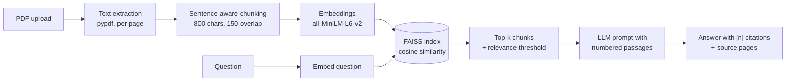

# DocuQuery: chat with your PDFs

Upload PDFs and ask questions in plain English. DocuQuery finds the relevant passages with semantic search and has an open-source LLM answer **only from those passages**, citing the file and page for every claim.

**Live demo:** https://huggingface.co/spaces/mayanklaxkar008/docuquery

## How it works



1. **Indexing.** Text is extracted page by page and cleaned (re-joined hyphenated words and wrapped lines). It is split into overlapping chunks that end on sentence boundaries and never cross pages, so every chunk maps to one page for citations.
2. **Embedding.** Each chunk becomes a 384-dimensional vector from `sentence-transformers/all-MiniLM-L6-v2`, running on CPU. Vectors are L2-normalised, so inner product equals cosine similarity.
3. **Retrieval.** The question is embedded the same way. A FAISS `IndexFlatIP` returns the top-k chunks. Chunks below a similarity threshold are dropped, so the app says "not found" instead of guessing.
4. **Generation.** The surviving chunks are numbered and sent with the question to an open-weight chat model (default `Qwen/Qwen2.5-7B-Instruct`) through Hugging Face Inference Providers. The system prompt restricts it to the passages and requires `[n]` citations.
5. **Graceful fallback.** If no token is set or the API fails, an extractive answerer returns the best-matching sentences with their citations, so the app always responds.

## Features

- Multiple PDFs at once, with per-file warnings for scanned, encrypted or broken files
- Cited answers plus a sources panel showing file, page, similarity score and passage
- Follow-up questions use recent chat history
- Each visitor gets a private index; the models are loaded once and shared
- "Try the sample" button with a built-in document
- 30 unit tests that run in seconds with a fake embedder and fake LLM
- CI on GitHub Actions; every green push to `main` deploys to the Space

## Retrieval evaluation

`scripts/evaluate_retrieval.py` runs 16 questions with known answer pages against the sample document and reports hit rate @k and mean reciprocal rank (MRR). Use it to compare chunk sizes and top-k:

```bash
python scripts/evaluate_retrieval.py
CHUNK_SIZE=500 CHUNK_OVERLAP=100 python scripts/evaluate_retrieval.py
```

## Run locally

```bash
git clone https://github.com/YOUR-GITHUB-USERNAME/docuquery.git
cd docuquery
python -m venv .venv && source .venv/bin/activate   # Windows: .venv\Scripts\activate
pip install -r requirements-dev.txt
export HF_TOKEN=hf_xxx        # optional; without it answers are extractive
python app.py                 # open http://127.0.0.1:7860
pytest -q
```

## Configuration

All settings are environment variables (on Spaces: Settings → Variables and secrets).

- `HF_TOKEN` (secret): Hugging Face token with "Make calls to Inference Providers" permission
- `LLM_MODEL`: chat model id, default `Qwen/Qwen2.5-7B-Instruct`
- `EMBEDDING_MODEL`: default `sentence-transformers/all-MiniLM-L6-v2`
- `CHUNK_SIZE` / `CHUNK_OVERLAP`: default 800 / 150 characters
- `TOP_K`: chunks retrieved per question, default 4
- `MIN_SCORE`: minimum cosine similarity to count as relevant, default 0.25
- `MAX_FILES` / `MAX_PAGES`: upload limits, default 5 files / 200 pages each

## Project structure

```
app.py                     Gradio UI and per-session state
rag/
  config.py                settings from environment variables
  loader.py                PDF text extraction and cleaning
  chunker.py               sentence-aware overlapping chunks
  embeddings.py            sentence-transformers wrapper
  vector_store.py          FAISS index with NumPy fallback
  llm.py                   prompt building, HF Inference client, extractive fallback
  pipeline.py              indexing and question answering
scripts/
  make_sample_pdf.py       builds the demo document
  evaluate_retrieval.py    hit rate and MRR
tests/                     pytest suite (no network or models needed)
.github/workflows/ci.yml   tests, then deploy to Hugging Face
```

## Limitations and next steps

- Scanned PDFs need OCR (for example Tesseract) before indexing.
- Tables lose structure in text extraction.
- The index lives in memory for the session; a persistent store (for example Chroma or pgvector) would suit larger collections.
- Possible improvements: hybrid BM25 + vector search, a cross-encoder re-ranker, and streaming responses.

## Licence

MIT
