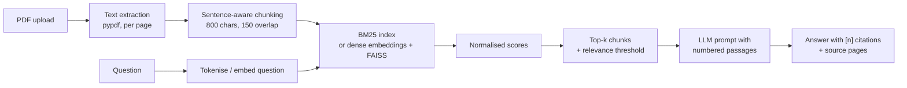

# DocuQuery: chat with your PDFs

Upload PDFs and ask questions in plain English. DocuQuery finds the relevant passages and has an open-weight LLM answer **only from those passages**, citing the file and page for every claim. It runs entirely on free tiers: BM25 retrieval on a free Render instance and an LLM on Groq's free API.

**Live demo:** https://docuquery-pwx0.onrender.com

## How it works



1. **Indexing.** Text is extracted page by page and cleaned (re-joined hyphenated words and wrapped lines). It is split into overlapping chunks that end on sentence boundaries and never cross pages, so every chunk maps to one page for citations.
2. **Retrieval (default: BM25).** Chunks are tokenised (stopwords removed, light stemming) into an in-memory BM25 index. Scores are normalised to 0..1 against the best score the question could get, so one threshold works across documents and off-topic questions return "not found" instead of a guess. No model, GPU or API key is needed, which keeps the app inside a 512 MB free instance. On the sample document BM25 reaches 100% hit rate @4 (MRR 0.91).
3. **Optional dense retrieval.** Set `EMBEDDING_BACKEND=api` (Hugging Face Inference API) or `local` (sentence-transformers) to embed chunks with `all-MiniLM-L6-v2` and search them with a FAISS inner-product index instead.
4. **Generation.** The surviving chunks are numbered and sent with the question to an open-weight model (default `openai/gpt-oss-120b` on Groq's free tier) through any OpenAI-compatible API. The system prompt restricts it to the passages and requires `[n]` citations.
5. **Graceful fallback.** If no API key is set or the call fails (rate limit, outage), an extractive answerer returns the best-matching sentences with their citations, so the app always responds.

## Features

- Multiple PDFs at once, with per-file warnings for scanned, encrypted or broken files
- Cited answers plus a sources panel showing file, page, similarity score and passage
- Follow-up questions use recent chat history
- Each visitor gets a private index; the LLM client is created once and shared
- "Try the sample" button with a built-in document
- Unit tests that run in seconds with fake embedders and a fake LLM (no network)
- A GitHub Actions keep-alive ping so the free instance stays awake for visitors
- CI on GitHub Actions; Render redeploys every push to `main` from `render.yaml`

## Retrieval evaluation

`scripts/evaluate_retrieval.py` runs 16 questions with known answer pages against the sample document and reports hit rate @k and mean reciprocal rank (MRR). Use it to compare chunk sizes and top-k:

```bash
python scripts/evaluate_retrieval.py
CHUNK_SIZE=500 CHUNK_OVERLAP=100 python scripts/evaluate_retrieval.py
```

## Run locally

```bash
git clone https://github.com/mayanklaxkar009/docuquery.git
cd docuquery
python -m venv .venv && source .venv/bin/activate   # Windows: .venv\Scripts\activate
pip install -r requirements-dev.txt
export GROQ_API_KEY=gsk_xxx   # optional; free at console.groq.com. Without it answers are extractive
python app.py                 # open http://127.0.0.1:7860
pytest -q
```

## Configuration

All settings are environment variables (on Render: the service's Environment tab).

- `GROQ_API_KEY` (secret): free Groq API key. `LLM_API_KEY` + `LLM_BASE_URL` work for any other OpenAI-compatible provider
- `LLM_MODEL`: chat model id, default `openai/gpt-oss-120b`
- `EMBEDDING_BACKEND`: `bm25` (default), `api` (needs `HF_TOKEN` with Inference credits) or `local` (needs `pip install sentence-transformers`)
- `EMBEDDING_MODEL`: dense model, default `sentence-transformers/all-MiniLM-L6-v2`
- `BM25_MIN_SCORE`: minimum normalised BM25 score to count as relevant, default 0.08
- `CHUNK_SIZE` / `CHUNK_OVERLAP`: default 800 / 150 characters
- `TOP_K`: chunks retrieved per question, default 4
- `MIN_SCORE`: minimum cosine similarity for dense retrieval, default 0.25
- `MAX_FILES` / `MAX_PAGES`: upload limits, default 5 files / 200 pages each

## Project structure

```
app.py                     Gradio UI and per-session state
render.yaml                Render Blueprint (free web service)
rag/
  config.py                settings from environment variables
  loader.py                PDF text extraction and cleaning
  chunker.py               sentence-aware overlapping chunks
  bm25.py                  BM25 index with normalised scores (default retriever)
  embeddings.py            optional dense embedders (HF Inference API or local)
  vector_store.py          FAISS index with NumPy fallback (dense mode)
  llm.py                   prompts, OpenAI-compatible client (Groq), HF client, extractive fallback
  pipeline.py              indexing and question answering
scripts/
  make_sample_pdf.py       builds the demo document
  evaluate_retrieval.py    hit rate and MRR
tests/                     pytest suite (no network or models needed)
.github/workflows/ci.yml   tests, then deploy to Hugging Face
```

## Limitations and next steps

- Scanned PDFs need OCR (for example Tesseract) before indexing.
- Tables lose structure in text extraction.
- The index lives in memory for the session; a persistent store (for example Chroma or pgvector) would suit larger collections.
- Possible improvements: hybrid BM25 + vector search, a cross-encoder re-ranker, and streaming responses.

## Licence

MIT
